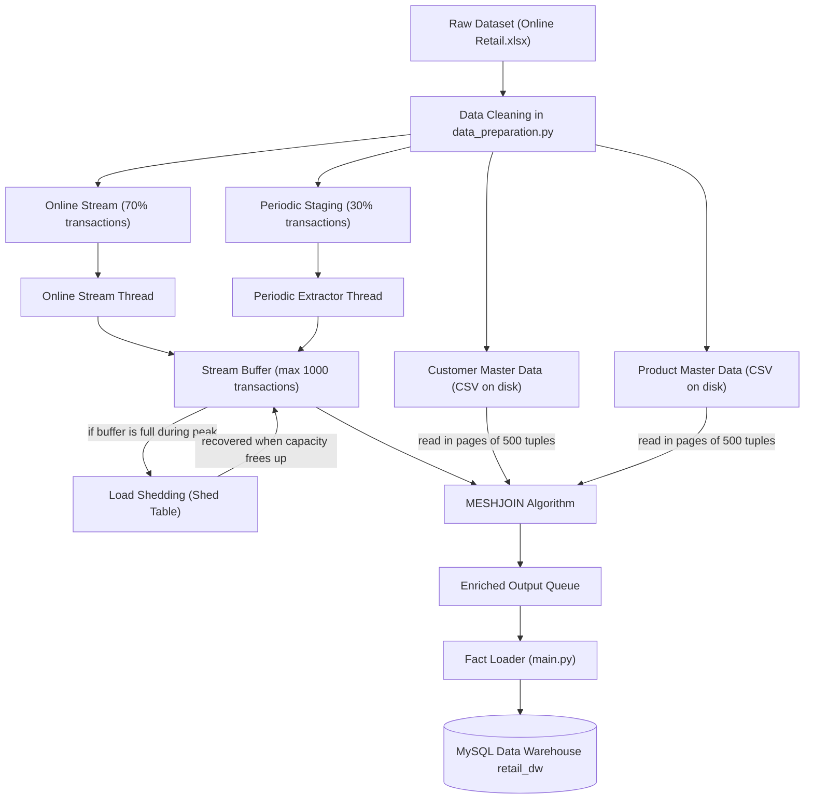
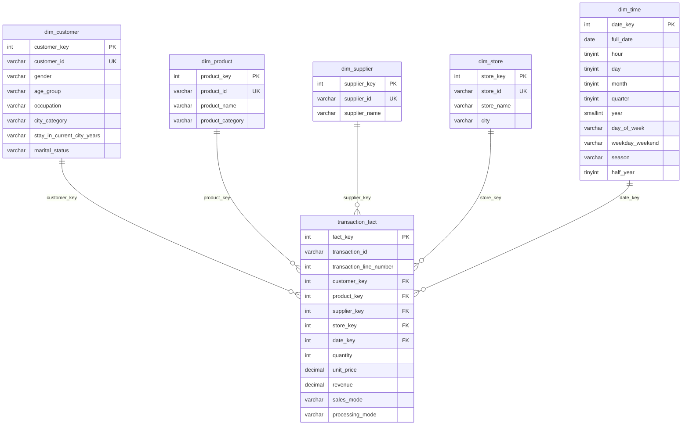
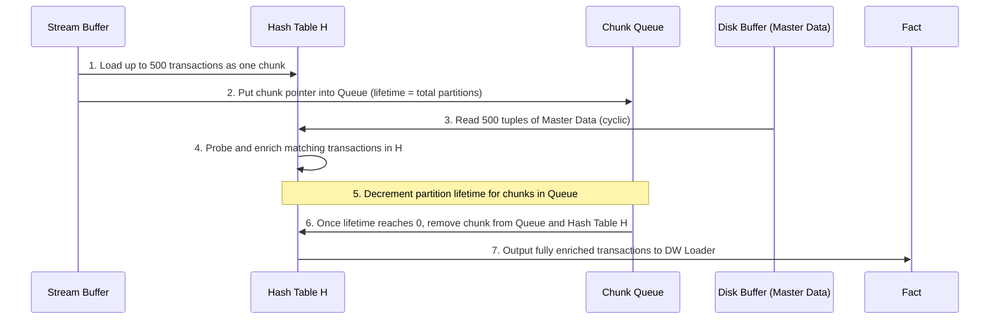

# Retail Data Warehouse with Near Real Time MESHJOIN

This is my semester project for DS3003 & DS3004 (Data Warehousing & Business Intelligence) at FAST-NUCES.

The goal of this project is to build an end-to-end Data Warehouse for a retail chain. The store gets transactions in two forms:
1. Online sales that arrive continuously as a stream and need to enter the data warehouse in near real time.
2. Physical store sales that are collected periodically (in hourly batches) from staging.

Because transactional sales data only comes with raw IDs, quantities, prices, and timestamps, we have to enrich every transaction with customer demographics and product/supplier details before loading it into the star schema. To join high-speed streaming data with master data stored on disk without crashing memory or slowing down the stream, I implemented the MESHJOIN (Mesh Join) algorithm in Python with multi-threading and load shedding.

---

## Project Structure

```text
final project/
├── Create-DW/
│   └── create_dw.sql           # Database schema, dimensions, fact table, staging, and view
├── Data/
│   ├── raw/
│   │   └── Online Retail.xlsx  # Raw dataset provided for the project
│   ├── processed/
│   │   ├── cleaned_transactions.csv
│   │   ├── customer_master_data.csv
│   │   ├── product_master_data.csv
│   │   ├── online_sales_stream.csv
│   │   └── periodic_sales_staging.csv
│   └── README.md               # Details about data counts, cleaning rules, and files
├── Mesh-Join/
│   ├── data_preparation.py     # Cleaning raw data and generating master data + streams
│   ├── database.py             # Script to populate dimensions into MySQL
│   ├── meshjoin.py             # Core MESHJOIN algorithm implementation
│   ├── threads.py              # Multi-threading (online stream, periodic extractor, worker)
│   ├── main.py                 # Pipeline controller and fact table loader
│   └── requirements.txt        # Python package dependencies
├── Queries-DW/
│   └── analysis_queries.sql    # 20 OLAP analytical business queries
└── README.md                   # This project guide
```

---

## Overall Architecture

The whole ETL pipeline works as follows:



---

## 1. Data Cleaning and Preparation

All data cleaning and splitting is handled in `Mesh-Join/data_preparation.py`.

### Cleaning Rules
According to the project instructions, we keep a transaction only if:
- `Quantity > 0` (removes damaged goods and return items)
- `UnitPrice > 0` (removes test items and zero price adjustments)
- `CustomerID` is present (drops guest checkouts without an ID)
- `InvoiceNo` does not start with `C` (drops cancelled shopping carts)

### Cleaning Numbers
- Transactions before cleaning: 541,909
- Transactions after cleaning: 397,884
- Transactions removed: 144,025

### Generating Master Data with MD5
The project requires that we generate customer demographics and product attributes without random numbers so that the data is 100% reproducible. I used an MD5 hash helper function:
```python
def stable(text, n):
    value = hashlib.md5(str(text).encode("utf-8")).hexdigest()[:8]
    return int(value, 16) % n
```
This guarantees that the exact same ID will always get the exact same attributes every time the code runs.

1. **Customer Master Data (`customer_master_data.csv`)**:
   - Total unique customers: 4,339 rows
   - Attributes generated: `customer_id`, `gender`, `age_group`, `occupation`, `city_category`, `stay_in_current_city_years`, `marital_status`.
2. **Product Master Data (`product_master_data.csv`)**:
   - Total unique products: 3,666 rows
   - Kept the cleanest, longest description for each stock code.
   - Assigned to 10 product categories and 5 suppliers (`Northwind Supplies`, `Atlantic Gifts Ltd`, `Midlands Wholesale`, `Celtic Craft Co`, `EuroPack Partners`).
3. **Splitting Online vs Periodic**:
   - Used `stable(transaction_id, 10) < 7` to split transactions into 70% online and 30% periodic.
   - Online stream: 278,740 transactions saved in `online_sales_stream.csv`.
   - Periodic staging: 119,144 transactions saved in `periodic_sales_staging.csv`, sorted chronologically and split across 48 hourly release periods.

---

## 2. Star Schema Design

The schema is defined in `Create-DW/create_dw.sql`.



### Fixed Dimensions
- **Stores**: 5 fixed stores as requested (`Online` on Web, `London Bridge` in London, `Manchester Arndale` in Manchester, `Birmingham Bullring` in Birmingham, `Edinburgh Princes` in Edinburgh).
- **Time Dimension**: Populated directly by `database.py` covering every single hour from December 1, 2010 to December 31, 2011 (9,480 hourly records with quarter, season, weekday/weekend, and half-year flags).

---

## 3. How MESHJOIN Works in This Project

In a real retail environment, master data on disk is too large to load all at once into RAM, and querying the database for every single streaming transaction would be way too slow. MESHJOIN solves this by streaming chunks of transactions through memory while cycling through master data from disk in pages.



### Components in `meshjoin.py`
1. **Stream Buffer**: A waiting queue (size 1,000) that holds incoming records so fast arrival bursts don't get lost.
2. **Disk Buffer (`DiskReader`)**: Reads master data files in pages of 500 tuples. It loops cyclically (`index = (index + 1) % total_pages`). Customer master data has 9 pages and product master data has 8 pages.
3. **Hash Table $H$**: A multi-map storing transactions in memory indexed by `customer_id` and `product_id`.
4. **Queue**: Keeps chunks in arrival order. A chunk of 500 transactions stays in memory until it has seen all 9 customer pages and all 8 product pages.
5. **Two-Pass Enrichment**:
   - Customer pass matches demographics (`gender`, `age_group`, `occupation`, `city_category`, `marital_status`).
   - Product pass matches product name, category, supplier, assigns store (`1` for online, or `2-5` for physical), and calculates `revenue = quantity * unit_price`.
6. **Chunk Eviction**: Only after a chunk finishes both full cycles is it safely popped from the queue and deleted from $H$.

---

## 4. Multi-Threading and Load Shedding

Multi-threading is implemented in `Mesh-Join/threads.py` using Python's `threading` library and a shared `threading.Lock`:

1. **`StreamProducerThread`**: Reads `online_sales_stream.csv` and continuously pushes batches into the stream buffer.
2. **`PeriodicExtractorThread`**: Simulates the periodic store extraction across the 48 release periods.
   - **Load Shedding**: If the stream buffer reaches capacity (1,000 items), periodic transactions are moved to a temporary `shed_queue` (representing the `shed_table` on disk).
   - **Shed Recovery**: Whenever the stream buffer has free room, the thread immediately reads back shed transactions and pushes them into MESHJOIN so zero transactions are lost.
3. **`MeshJoinWorkerThread`**: Runs the MESHJOIN join iterations and feeds enriched output tuples into the database loader queue.

---

## 5. Prerequisites and Setup

### Requirements
- Python 3.8+
- MySQL Server (8.0+)
- MySQL Workbench (or MySQL CLI)

### Install Python Libraries
From the project folder, run:
```bash
pip install -r Mesh-Join/requirements.txt
```

---

## 6. How to Run the Project Step by Step

### Step 1: Create the Database Schema
Open MySQL Workbench (or terminal) and run the SQL script to create the database, tables, and views:
```bash
mysql -u root -p < "Create-DW/create_dw.sql"
```
Or open `Create-DW/create_dw.sql` inside MySQL Workbench and click the lightning icon to execute all.

### Step 2: Clean Raw Data and Generate Master Data
Run the data preparation script:
```bash
python3 "Mesh-Join/data_preparation.py"
```
This will:
- Read `Data/raw/Online Retail.xlsx`
- Clean invalid records and drop cancellations
- Generate `customer_master_data.csv` and `product_master_data.csv`
- Generate `online_sales_stream.csv` and `periodic_sales_staging.csv`

### Step 3: Populate Dimension Tables
Run the database dimension loader:
```bash
python3 "Mesh-Join/database.py"
```
Enter your MySQL root password when prompted. This inserts all customers, suppliers, products, the 5 stores, and the hourly time records into MySQL.

### Step 4: Run the MESHJOIN Pipeline and Load Fact Table
Run the main controller:
```bash
python3 "Mesh-Join/main.py"
```
Enter your MySQL password. This starts the threads, executes the cyclic MESHJOIN, enriches all transactions, and batch-inserts the final records into `transaction_fact`.

When it completes, it prints the summary:
- Total execution time
- Online transactions pushed
- Periodic transactions pushed
- Shed and recovered transaction counts
- Total fact records inserted into the data warehouse

### Step 5: Run the Analytical Queries
Open `Queries-DW/analysis_queries.sql` in MySQL Workbench and run the queries to answer the 20 business questions (product performance, customer demographics, quarterly sales, seasonal analysis, rollup summaries, and the `STORE_QUARTERLY_SALES` view).

---

## 7. Deliverables Checklist

- [x] Data cleaning program (`Mesh-Join/data_preparation.py`)
- [x] Master data generation with deterministic MD5 (`customer_master_data.csv`, `product_master_data.csv`)
- [x] Online stream and periodic staging files (`online_sales_stream.csv`, `periodic_sales_staging.csv`)
- [x] Star schema DDL with staging and shed tables (`Create-DW/create_dw.sql`)
- [x] Dimension table population script (`Mesh-Join/database.py`)
- [x] Full MESHJOIN implementation (`Mesh-Join/meshjoin.py`)
- [x] Multi-threading with load shedding and recovery (`Mesh-Join/threads.py`)
- [x] Fact table loading and execution pipeline (`Mesh-Join/main.py`)
- [x] 20 OLAP business queries and view (`Queries-DW/analysis_queries.sql`)

